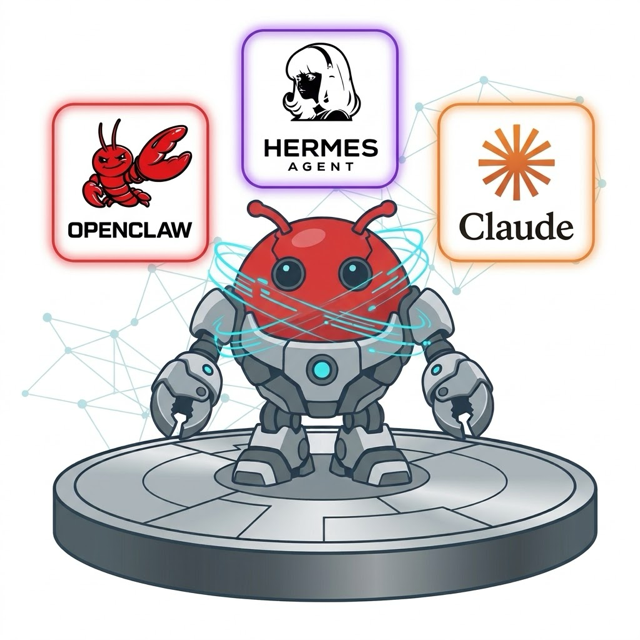

# Open Agents Enterprise

Open Agents Enterprise (OAE) runs an organisation's AI agents on its own servers, under one
console: **OpenClaw**, **Hermes** and **Claude**. People sign in with the company login, see only
the Agents they are granted, and reach them from the browser, their phone, Microsoft Teams or
Slack, Hermes Desktop, or their own Claude Code and Claude Desktop.



OAE is an independent fork of [OpenClaw Enterprise (OCE)](https://github.com/openclaw/openclaw-enterprise),
the open source, vendor-neutral platform for managing agents ("Kubernetes for agents"). It keeps
OCE's control plane, console and Kubernetes deployment, and adds the agents and access below.
[`OAE.md`](OAE.md) lists what the fork adds and how it stays close to upstream. OAE is not
affiliated with or endorsed by the OpenClaw project, Nous Research or Anthropic; OpenClaw, Hermes
and Claude are the names and marks of their owners.

## What you can run

Every Agent is created in the console (**Create Agent → Provider → Harness**), versioned, audited
and granted to people like any OCE Agent.

| Agent                     | What it is                                                                                                                                       | How people use it                                                                                          |
| ------------------------- | ------------------------------------------------------------------------------------------------------------------------------------------------ | ---------------------------------------------------------------------------------------------------------- |
| **OpenClaw**              | OCE's own Agent: OpenClaw's gateway, Embedded or Dedicated                                                                                       | Its web UI, the OpenClaw mobile app, Microsoft Teams, Slack                                                |
| **Hermes**                | Nous Research's Hermes Agent as a second Agent kind                                                                                              | Its web UI, Hermes Desktop, Microsoft Teams                                                                |
| **Claude Code** (harness) | An OpenClaw Agent whose turns run through Claude Code, on an Anthropic key or a person's own Claude subscription                                 | The same as OpenClaw ([details](docs/oae/claude-harness.md))                                               |
| **Claude Gateway**        | Anthropic's `claude gateway` for a team: one Anthropic key, Keycloak sign-in, models per group, personal data masked before it reaches Anthropic | People's own Claude Code and Claude Desktop, over a private tunnel ([details](docs/oae/claude-gateway.md)) |

Models: OpenAI, Anthropic, or any OpenAI-compatible HTTPS endpoint (NVIDIA, for example).

## People and access

- **Single sign-on** through Keycloak, which can hand sign-in to Microsoft Entra ID, Google or
  Okta ([Keycloak for OAE](deploy/oae/central-sso/README.md)).
- **Per-Agent grants**: an Agent's People card decides who may use it.
- **`/apps`**: each person connects their own phone, Hermes Desktop, or Claude Code and Claude
  Desktop, with one-time setup for macOS, Windows and Linux.

Administrators start with the [administrator guide](docs/oae/admin-guide.md).

## Install

- **Packaged:** manidae-cloud installs OAE on a Hetzner server or your own, with single sign-on and the Claude Gateway as form options.
- **By hand:** follow OCE's [Kubernetes Setup](docs/guides/kubernetes-setup.md), then the OAE
  pieces in the [administrator guide](docs/oae/admin-guide.md).

## The OCE platform underneath

The rest of this page is OCE's, and applies unchanged to OAE.

OCE includes the [OpenClaw Control Plane (OCC)](docs/guides/concepts.md#control-plane)
for deploying and managing [Agents](docs/guides/concepts.md#agents-and-revisions).
Start with [Getting Started](docs/README.md) to use the platform, [Operate](docs/guides/operate/README.md) to administer it, or [Contribute](docs/contributing/README.md) to change its source.

### Getting started

Choose [Local Setup](docs/guides/quickstart.md) to run OCC on your machine, or [Kubernetes Setup](docs/guides/kubernetes-setup.md) to install it on a cluster you already operate. For local setup, run from the repository root:

```bash
go build -trimpath -o bin/occ ./cmd/occ
export OCC_DEVELOPMENT_COMPUTE_DRIVER=kubernetes
export OCC_DEVELOPMENT_CONTROL_PLANE=kubernetes
export OCC_DEVELOPMENT_SANDBOX_DRIVER=none
./bin/occ dev up
```

This selects the Kubernetes-only profile for Agent deployment. With no profile
selection, `occ dev up` starts a Compose control-plane preview that cannot deploy
Agents.

You need Docker Engine or Podman, k3d, kubectl, Helm, Bash, Python 3, Go (the version in [`go.mod`](go.mod)), Node.js 24.22.1 or newer, and the pnpm version in [`package.json`](package.json). The quickstart covers installation checks, the local API credentials, and cleanup.

After local setup, [deploy your first Agent](docs/guides/first-agent.md) and send it a model request. You need an OpenAI API key with access to the [default model or your selected override](docs/guides/first-agent.md#before-you-start) for that step. If you installed on an existing cluster, [deploy and verify an Agent on that installation](docs/guides/deploy/production-agents.md).

Reuse settings with [Agent Presets](docs/guides/topics/agent-presets.md), then fill variables and review the copied draft in the console.

### Develop

Follow [Make your first platform change](docs/contributing/first-change.md) for
setup, a small source edit, and focused verification. You need Node.js 24.22.1 or
newer, the pnpm version pinned in [`package.json`](package.json), and the Go
version selected by [`go.mod`](go.mod).

Use the [local checks](docs/testing/local.md) for the current formatting, lint,
type, CLI, and API commands; follow the [contribution policy](CONTRIBUTING.md)
before opening a PR. [Testing](docs/testing/README.md) explains additional
PostgreSQL, Docker/Podman, and Kubernetes setup; [CI coverage](docs/testing/ci.md#github-actions)
distinguishes PR-safe checks from protected integrations.

### Code layout

| Path                                          | Responsibility                                                                                  |
| --------------------------------------------- | ----------------------------------------------------------------------------------------------- |
| `apps/controller/`                            | HTTP API, browser console, worker, and [Drivers](docs/guides/concepts.md#drivers-and-backends). |
| `packages/contracts/`                         | Resource models, Driver interfaces, and API schemas.                                            |
| `packages/occ/`                               | Resource lifecycle, persistence, and work queue.                                                |
| `packages/iam/`                               | Identities, roles, and resource authorization.                                                  |
| `packages/audit/`                             | Audit events and sensitive-value sanitization.                                                  |
| `cmd/occ/`                                    | Go entry point for the OCC domain CLI.                                                          |
| `internal/occcli/`                            | OCC resource commands and human or structured output.                                           |
| `internal/occclient/`                         | Internal Go client that owns OCC transport and authentication.                                  |
| [`packages/utils/`](packages/utils/README.md) | Shared validation, hashing, and object helpers.                                                 |
| `tests/`                                      | Conformance and integration tests.                                                              |

### Documentation

Run `npm run docs:install` once, then `npm run docs:dev` to preview the docs at <http://127.0.0.1:4173>.
Use `npm run docs:build` for the full static build. See the
[local preview instructions](docs/local-preview.md) for setup and checks.

- [Getting Started](docs/README.md) and [Concepts](docs/guides/concepts.md): setup, the first Agent, and the product model.
- [Topics](docs/guides/topics/README.md) and [Integrations](docs/guides/integrations/README.md): feature behavior and named implementations.
- [Operate](docs/guides/operate/README.md) and [Reference](docs/reference/README.md): platform operations, the CLI, and the HTTP API.
- [Contribute](docs/contributing/README.md): development, design, and documentation.

## Contributors

OAE builds on the work of OpenClaw Enterprise's contributors. Thanks to everyone contributing
code, documentation, reviews, and ideas upstream.
See the [full contributor graph](https://github.com/openclaw/openclaw-enterprise/graphs/contributors)
and [how to update recognition](CONTRIBUTING.md#recognize-contributors).

<!-- contributors:start -->

<a href="https://github.com/derekwaynecarr"></a> <a href="https://github.com/drew"></a> <a href="https://github.com/ericcaiwx-star"></a> <a href="https://github.com/freeqaz"></a> <a href="https://github.com/freeqaz-openai"></a> <a href="https://github.com/jacobtomlinson"></a> <a href="https://github.com/kevinlin-openai"></a> <a href="https://github.com/kevinslin"></a> <a href="https://github.com/Kimiyu-186"></a> <a href="https://github.com/mrunalp"></a>
<a href="https://github.com/natedemoss"></a> <a href="https://github.com/rclarke0"></a> <a href="https://github.com/RomneyDa"></a> <a href="https://github.com/russellb"></a> <a href="https://github.com/sallyom"></a> <a href="https://github.com/sjenning"></a> <a href="https://github.com/steipete"></a> <a href="https://github.com/stevenlee-oai"></a> <a href="https://github.com/vincentkoc"></a>

<!-- contributors:end -->

## License

[MIT](LICENSE), as upstream OpenClaw Enterprise. Third-party components retain their own licenses.
